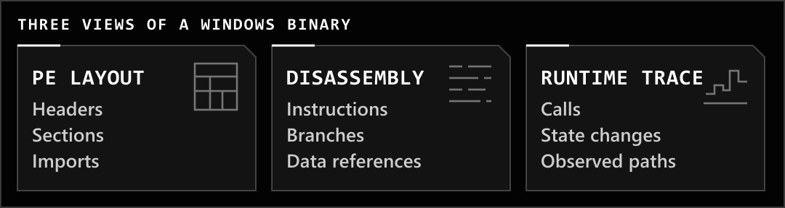
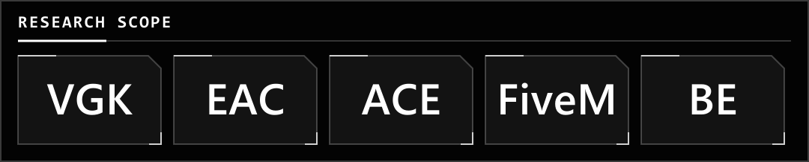
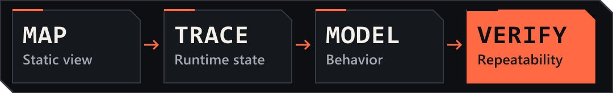

# Reverse Engineer · Anti-Cheat Researcher

I'm **hexreys**. I reverse engineer Windows software, from native applications and game clients to the layers that protect them. When I look at a decision in a binary, I want to know which state it reads, where that state comes from, and what would change the outcome.

A decompiler gives me a starting point. I use static analysis and runtime observations to turn an unfamiliar binary into a model I can test. If a question keeps coming up, I build a tool to make the next investigation easier.

[Research focus](#research-focus) · [How I work](#how-i-work) · [Custom tools](#custom-tools)

## Research focus

### Application reverse engineering

I work through native code, control flow, data structures, and module boundaries. I like questions that connect a visible behavior to the underlying implementation, such as where an application stores its state or which path produces a particular result. I give functions and fields names as their roles become clear, then check those names against what the program does at runtime.

For a Windows executable, three views are especially useful. The file layout gives me the sections and imports. The instruction stream shows reads, writes, branches, and calls. A runtime trace shows which of those paths were taken for a particular input.

### Devirtualization

Virtualized code interests me because a single routine can hide behind two layers of semantics. I look at the virtual machine's state, its instruction set, and what its handlers do to that state. Recovering a readable description of the routine means accounting for the original branches and data dependencies as well as the behavior of individual instructions.

I think about a VM handler as a state transition. A useful description records which values it consumes, which fields it changes, and what determines the next virtual instruction. That makes it possible to compare handlers that look different at the native instruction level.

### Anti-cheat and game clients

I study anti-cheat internals, client behavior, cheats, and bypasses. The questions I come back to are where an integrity decision is made, what information it depends on, and how the result travels between components. My areas of interest include **VGK**, **EAC**, **ACE**, **FiveM**, and **BE**.

## How I work

- **Map.** Identify the modules, routines, and state relevant to the question. Give recurring structures a name so the investigation is easier to follow.
- **Trace.** Compare the static view with observable events and state changes at runtime.
- **Model.** Describe the behavior in terms of inputs, decisions, and outputs. Record which parts still depend on an assumption.
- **Verify.** Change an input or rerun a case and check whether the model predicts what happens.

### Example question · Where does an application get a setting?

I'd collect two runs that differ only in the setting, then compare what the application reads and writes. A candidate field earns its name when its observed width and values agree with the instructions that access it. If a read happens in both runs, I'd check which later decision actually depends on the value. The notes would include the binary build, the input I changed, and the observation that would make me revise the explanation.

## Custom tools

I build small utilities for inspecting binaries, comparing outputs, and collecting observations in a form I can revisit. Sometimes the right tool is a parser for a format I keep seeing. Sometimes it's a script that makes two traces easy to compare. I prefer tools that capture enough context for me to pick up an investigation later and reproduce the same result.

- **Binary inspection.** Summarize file headers and sections, and carry file offsets alongside the addresses used in analysis.
- **Trace comparison.** Normalize addresses against module bases, keep module identity, and group repeated events before comparing two runs.
- **Research notes.** Record the build and input, the evidence behind a hypothesis, and the checks that still need to be repeated.
